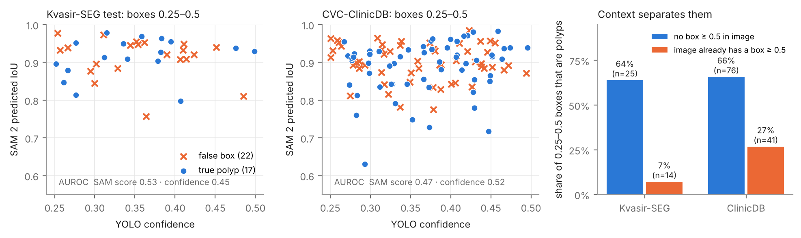

# F26-13 — Phase 5 report: Output analysis

**Project:** Confidence-Aware Self-Prompting for Robust Polyp Segmentation Under Image and Domain Shifts · Track A.

**Summary.** Phases 3–4 showed that our method CASP v1 (**C**) beats the YOLO → SAM 2 baseline (**B**) \[1\]–\[3\] on Kvasir-SEG \[4\], on CVC-ClinicDB \[5\] (another hospital) and on nine image corruptions, but that the whole gain comes from its confidence gate: lowering the threshold alone (**T**) does as well, and SAM 2's score never rejected a box. Phase 5 asks *why*, using the saved Phase 3 logs (1,175 candidate boxes with their YOLO confidence and SAM 2 score, ground-truth boxes from the oracle run **O**) and one new Colab job, a second detector trained with seed 43; no Phase 3 number changed. We (i) decompose the remaining error, (ii) test which signals can tell a real polyp box from a false one, (iii) explain the results theoretically and (iv) test a rule fixed in advance from that theory, the **fallback rule F** (DL-44), and (v) repeat the key results with the second detector. Code: `src/eval/filter_analysis.py`, `src/eval/seed_compare.py`; tables: `docs/tables/phase5/`; decisions DL-44, DL-45 and DL-47.

## 1. Experimental results

## 2. Error analysis

## 3. Theoretical insights

### 3.1 Domain shift lowers detector confidence before it removes detections

A detector's confidence is calibrated, at best, on its training distribution; under dataset shift its scores drift and usually drop \[8\]. Our logs show exactly this: the median confidence of true polyp boxes falls from 0.873 on Kvasir-SEG to 0.794 on ClinicDB, the share of true boxes at ≥ 0.5 falls from 88.6% to 77.3%, and the share below 0.25 rises from 3.0% to 12.0%. A threshold of 0.5 chosen on the source domain therefore loses recall precisely where it matters, and lowering it to 0.25 moves the operating point back along the precision–recall curve. Whether that is worth it is a cost question: a box should be kept when P(polyp \| box) × gain from a found polyp exceeds (1 − P) × cost of a false alarm \[9\]. Between 0.25 and 0.5, P(polyp) is about 0.44 on Kvasir-SEG (17 of 39 boxes) and 0.52 on ClinicDB (61 of 117); in screening, where a missed polyp is the costlier error, keeping such boxes is the right decision on average. This is the whole of CASP's gain over B.

### 3.2 Why SAM 2's score cannot filter false boxes

SAM 2's IoU head is trained to predict the IoU between the mask it outputs and the object the *prompt* designates \[3\], \[6\]. It answers "is this a clean, complete segment of whatever is in the box?", not "is the thing in the box a polyp?". A fold, a light reflection or a bubble inside a false box is a well-defined object, so SAM 2 segments it cleanly and scores it high. The data agree (Figure 1): among the kept boxes, 91% (Kvasir-SEG) and 96% (ClinicDB) of the false ones score ≥ 0.8, and inside the 0.25–0.5 band the SAM 2 score separates true from false boxes no better than chance (AUROC 0.53 \[0.34, 0.71\] and 0.47 \[0.37, 0.58\]). Over all kept boxes it does reach 0.69 and 0.66, but only because it is correlated with YOLO's confidence (r = 0.36 and 0.44): multiplying the two gives 0.861 and 0.822, identical to confidence alone (0.861, 0.820). SAM 2's score adds no information about *class*, which is why the acceptance rule of Phase 3 never fired at any threshold we could set. The same argument explains why the candidate prompts and self-prompting were neutral: for a correct box SAM 2 is already near the oracle (E\[Dice \| mask\] 0.95 with ground-truth boxes), and choosing the best of several highly correlated candidates by a noisy estimate of quality mostly selects the candidate whose score is over-estimated, so the expected gain is close to zero and can be negative \[7\].

<figure>

</figure>

**Figure 1.** Every box T kept with confidence 0.25–0.5, labelled against the ground-truth boxes. *Left, centre:* true polyps (blue dots) and false boxes (orange crosses) overlap completely in YOLO confidence and in SAM 2's predicted IoU. *Right:* whether the image already has a box ≥ 0.5 separates them (AUROC 0.77 on Kvasir-SEG, 0.68 on ClinicDB).

### 3.3 The missing information is context, and it leads to the fallback rule

If neither per-box score carries the class, the information has to come from the rest of the image. Most colonoscopy frames show one polyp (194 of 200 Kvasir-SEG and 582 of 612 ClinicDB test images), so by Bayes' rule an uncertain box is far less likely to be a polyp when a confident one has already been found: in our logs 7% (1 of 14) versus 64% (16 of 25) on Kvasir-SEG and 27% (11 of 41) versus 66% (50 of 76) on ClinicDB (Figure 1, right). This is the reasoning behind F, written down before computing its results (DL-44) and using only the existing thresholds 0.25 and 0.5, so nothing was tuned on the test sets. F acts as an image-level suppression step with a single-polyp prior. Its limits follow from the same prior: it removes real second polyps and fragments of large polyps (ClinicDB box recall 0.780 → 0.763), and under strong noise, where the confident box itself is more often wrong, the uncertain box it discards is sometimes the polyp (noise severity 2). The 75 ClinicDB images with no box above 0.25 are out of reach of any rule that only re-ranks YOLO's boxes; they need a detector that transfers better (training on both hospitals, or test-time adaptation).

### 3.4 Does it hold for a second detector?

Rule F was designed after looking at the errors of the seed-42 detector, so we retrained YOLOv8-m with seed 43 (same recipe, DL-31; test mAP50 0.924 vs 0.943, recall 0.855 vs 0.908) and repeated B, T and C on both test sets, reusing the committed configs and saving everything to new folders (`notebooks/08_phase5_seed43_colab.ipynb`, `docs/tables/phase5/seed_comparison.csv`). The gate's gain over B holds on both sets but is smaller on Kvasir-SEG, where the new baseline misses fewer polyps (10 instead of 18). F replicates: its Dice equals T's, it again removes extra-box images and raises box F1. SAM 2's score again fails as a filter in the 0.25–0.5 band, while image context stays informative; on ClinicDB, YOLO confidence carries a little signal with this detector. Two seeds show that the conclusions hold for both trained detectors; they do not give an interval over training randomness.

|                                              | Kvasir-SEG test           |                           | CVC-ClinicDB              |                           |
|----------------------------------------------|---------------------------|---------------------------|---------------------------|---------------------------|
| Seed                                         | 42                        | 43                        | 42                        | 43                        |
| Dice B / T / C / F                           | .831 / .893 / .891 / .895 | .856 / .885 / .885 / .890 | .677 / .760 / .757 / .756 | .712 / .783 / .782 / .782 |
| C − B \[95% CI\]                             | +.061 \[+.032, +.090\]    | +.028 \[+.004, +.057\]    | +.080 \[+.060, +.100\]    | +.070 \[+.052, +.089\]    |
| F − T \[95% CI\]                             | +.002 \[−.003, +.006\]    | +.005 \[−.006, +.018\]    | −.003 \[−.010, +.002\]    | −.000 \[−.006, +.005\]    |
| Missed images B / T                          | 18 / 1                    | 10 / 0                    | 144 / 75                  | 123 / 52                  |
| Extra-box images T → F                       | 29 → 21                   | 25 → 19                   | 59 → 29                   | 56 → 24                   |
| Box F1 T → F                                 | .871 → .894               | .852 → .873               | .799 → .808               | .815 → .825               |
| Band AUROC: SAM score / confidence / context | .53 / .45 / .77           | .40 / .46 / .74           | .47 / .52 / .68           | .42 / .61 / .63           |

**Table 2.** Key results for the two detector seeds. Dice values are means of per-image rows (seed-42 T on ClinicDB is 0.760 this way, 0.759 in the Phase 3 table). Band AUROC: boxes with confidence 0.25–0.5 kept by T, labelled against the oracle's ground-truth boxes.

## 4. Functionality and reproducibility

## 5. Conclusions

1.  CASP's improvement is a recall effect of the confidence gate, and it is explained by domain shift lowering detector confidence (§3.1); the refinement steps cannot add to it because SAM 2's score measures mask quality, not class (§3.2).
2.  A context rule fixed in advance (F) keeps all of the gate's recall, matches T and C in Dice and removes about half of their false boxes on the unseen hospital, at the price of some second polyps and of robustness under strong noise. Both F's effect and the gate's gain hold for a second, independently trained detector (§3.4).
3.  The remaining error on the training hospital is box quality; on the unseen hospital it is mostly polyps the detector never proposes. Further gains must come from the detector, not from prompting SAM 2 differently.

**Work division.** Kashish Fatima (lead): results, decision log, review. Khushbakht Sohail: hosted demo, error analysis, reproducibility. Zahra Saeed: filter analysis, second detector seed, theoretical insights, notebooks.

### References

1.  M. Mansoori, S. Shahabodini, J. Abouei, K. N. Plataniotis, and A. Mohammadi, “Self-prompting polyp segmentation in colonoscopy using hybrid YOLO-SAM 2 model,” 2024, *arXiv:2409.09484*.
2.  G. Jocher, A. Chaurasia, and J. Qiu, “Ultralytics YOLOv8,” 2023. \[Online\]. Available: https://github.com/ultralytics/ultralytics
3.  N. Ravi *et al.*, “SAM 2: Segment anything in images and videos,” 2024, *arXiv:2408.00714*.
4.  D. Jha *et al.*, “Kvasir-SEG: A segmented polyp dataset,” in *MultiMedia Modeling (MMM 2020)*, LNCS, vol. 11962. Cham, Switzerland: Springer, 2020, pp. 451–462.
5.  J. Bernal *et al.*, “WM-DOVA maps for accurate polyp highlighting in colonoscopy: Validation vs. saliency maps from physicians,” *Comput. Med. Imag. Graph.*, vol. 43, pp. 99–111, 2015.
6.  A. Kirillov *et al.*, “Segment anything,” in *Proc. IEEE/CVF Int. Conf. Comput. Vis. (ICCV)*, 2023, pp. 4015–4026.
7.  J. E. Smith and R. L. Winkler, “The optimizer's curse: Skepticism and postdecision surprise in decision analysis,” *Manage. Sci.*, vol. 52, no. 3, pp. 311–322, 2006.
8.  Y. Ovadia *et al.*, “Can you trust your model's uncertainty? Evaluating predictive uncertainty under dataset shift,” in *Adv. Neural Inf. Process. Syst. (NeurIPS)*, 2019.
9.  C. Elkan, “The foundations of cost-sensitive learning,” in *Proc. Int. Joint Conf. Artif. Intell. (IJCAI)*, 2001, pp. 973–978.
