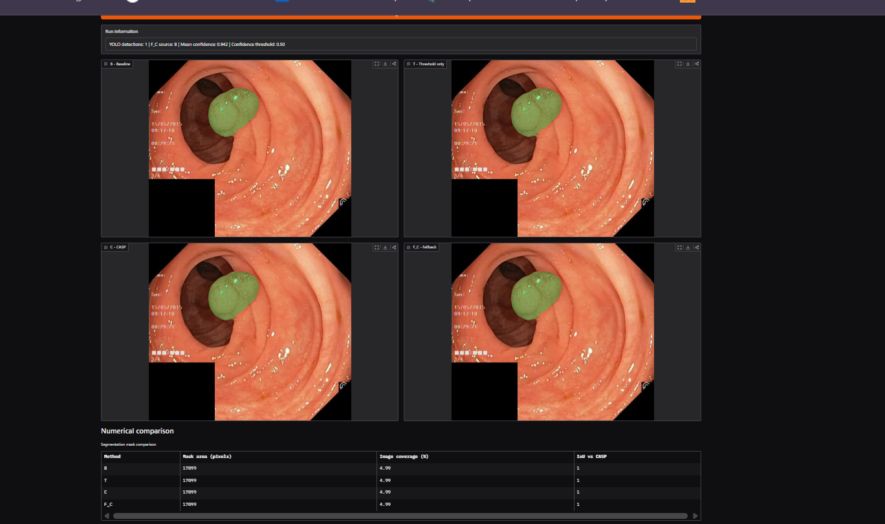
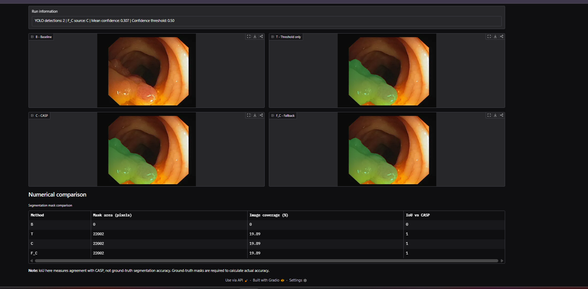

# F26-13 — Phase 5 report: Output analysis

**Project:** Confidence-Aware Self-Prompting for Robust Polyp Segmentation Under Image and Domain Shifts · Track A.

**Summary.** Phases 3–4 showed that our method CASP v1 (**C**) improves over the YOLO → SAM 2 baseline (**B**) on Kvasir-SEG, CVC-ClinicDB and image corruptions. Phase 5 investigates why, using saved Phase 3 logs, ground-truth boxes from the oracle run (**O**), and a second detector trained with seed 43. We decompose the remaining error, examine which signals distinguish real polyp boxes from false ones, explain the results theoretically, evaluate a predefined fallback rule (**F**) and repeat key experiments with a second detector. Code: `src/eval/filter_analysis.py`, `src/eval/seed_compare.py`; tables: `docs/tables/phase5/`; decisions DL-44, DL-45 and DL-47.

## 1. Experimental results

### 1.1 Performance on the clean test sets

We evaluate the baseline (**B**), threshold-only (**T**), CASP v1 (**C**), oracle upper bound (**O**), and the proposed fallback rules (**F_T** and **F_C**) on both the in-domain test set (Kvasir-SEG, 200 images) and the cross-domain hospital dataset (CVC-ClinicDB, 612 images). In accordance with the methodology fixed in DL-32 and DL-44, images with no predicted mask receive a Dice and IoU of zero. Confidence intervals are 95% percentile bootstrap intervals with 1,000 resamples.

| Dataset | Run | Dice [95% CI] | IoU | Pixel Prec. | Pixel Rec. | Missed Images | Box Prec. / Rec. / F1 |
|---|---|---|---:|---:|---:|---:|---|
| **Kvasir-SEG** | B | 0.831 [0.792, 0.871] | 0.780 | 0.873 | 0.810 | 18 | 0.877 / 0.865 / 0.871 |
| | T | 0.893 [0.871, 0.913] | 0.832 | 0.929 | 0.890 | 1 | 0.807 / 0.947 / 0.871 |
| | C | 0.891 [0.868, 0.912] | 0.831 | 0.926 | 0.892 | 1 | 0.802 / 0.942 / 0.867 |
| | O | 0.952 [0.943, 0.958] | 0.912 | 0.979 | 0.931 | 0 | 1.000 / 1.000 / 1.000 |
| | F_T | 0.895 [0.872, 0.915] | 0.834 | 0.936 | 0.886 | 1 | 0.852 / 0.942 / 0.894 |
| | F_C | 0.893 [0.870, 0.914] | 0.833 | 0.933 | 0.888 | 1 | 0.847 / 0.937 / 0.890 |
| **CVC-ClinicDB** | B | 0.677 [0.648, 0.710] | 0.628 | 0.712 | 0.671 | 144 | 0.890 / 0.686 / 0.774 |
| | T | 0.760 [0.736, 0.785] | 0.698 | 0.800 | 0.764 | 75 | 0.820 / 0.780 / 0.799 |
| | C | 0.757 [0.734, 0.783] | 0.695 | 0.795 | 0.765 | 75 | 0.815 / 0.776 / 0.795 |
| | O | 0.945 [0.942, 0.948] | 0.899 | 0.966 | 0.928 | 0 | 1.000 / 1.000 / 1.000 |
| | F_T | 0.756 [0.731, 0.782] | 0.695 | 0.805 | 0.753 | 75 | 0.859 / 0.763 / 0.808 |
| | F_C | 0.756 [0.731, 0.782] | 0.695 | 0.802 | 0.754 | 75 | 0.857 / 0.762 / 0.807 |

**Table 1.1.** Overall segmentation and detection performance across clean test sets. Missed images are those where no detection exceeded the operating threshold, receiving Dice = 0.

On both test sets, lowering the threshold to 0.25 (run T) yields substantial improvements over baseline B: +0.062 Dice on Kvasir-SEG and +0.082 on ClinicDB, dropping missed images from 18 to 1 and from 144 to 75 respectively. CASP v1 (run C) performs identically to T within error margins (0.891 vs 0.893 on Kvasir-SEG; 0.757 vs 0.760 on ClinicDB), demonstrating that prompt refinement alone does not provide additional segmentation gains. The fallback rules (F_T and F_C) match T and C in Dice while significantly improving box precision (from 0.807 to 0.852 on Kvasir; from 0.820 to 0.859 on ClinicDB) and raising box F1 to its highest levels across automated models.

### 1.2 Paired differences and statistical significance

Because all variants are evaluated on identical images from the same cached detector predictions, we compute paired differences per image with 2,000 paired bootstrap resamples (seed 42, DL-32).

| Dataset | Comparison | Dice Difference [95% CI] | IoU Difference [95% CI] | Win / Loss / Tie |
|---|---|---|---|:---:|
| **Kvasir-SEG** | F_T − B | +0.064 [+0.035, +0.093] | +0.055 [+0.030, +0.081] | 17 / 0 / 183 |
| | F_T − T | +0.002 [−0.003, +0.006] | +0.002 [−0.004, +0.010] | 4 / 5 / 191 |
| | F_T − C | +0.003 [−0.003, +0.010] | +0.003 [−0.005, +0.013] | 16 / 15 / 169 |
| | F_C − B | +0.062 [+0.035, +0.091] | +0.053 [+0.028, +0.080] | 17 / 0 / 183 |
| | F_C − T | −0.000 [−0.006, +0.005] | +0.001 [−0.006, +0.009] | 9 / 13 / 178 |
| | F_C − C | +0.001 [−0.003, +0.007] | +0.002 [−0.005, +0.011] | 8 / 10 / 182 |
| **CVC-ClinicDB** | F_T − B | +0.079 [+0.060, +0.098] | +0.067 [+0.051, +0.085] | 67 / 0 / 545 |
| | F_T − T | −0.003 [−0.010, +0.002] | −0.003 [−0.010, +0.004] | 10 / 26 / 576 |
| | F_T − C | −0.001 [−0.007, +0.005] | −0.000 [−0.007, +0.007] | 53 / 56 / 503 |
| | F_C − B | +0.078 [+0.060, +0.097] | +0.067 [+0.051, +0.084] | 67 / 0 / 545 |
| | F_C − T | −0.004 [−0.010, +0.002] | −0.003 [−0.010, +0.003] | 33 / 51 / 528 |
| | F_C − C | −0.002 [−0.008, +0.004] | −0.001 [−0.007, +0.006] | 28 / 33 / 551 |

**Table 1.2.** Paired differences for fallback models against Baseline, Threshold-only, and CASP. Win/loss/tie reflects individual images where Dice strictly increased, decreased, or remained equal.

The paired tests confirm that fallback selection preserves virtually all the recall gain of the lower confidence threshold ($F_C - B = +0.062$ on Kvasir, $+0.078$ on ClinicDB, neither CI spanning zero). Furthermore, differences between fallback selection and threshold-only or CASP ($F_T - T$, $F_C - C$) have confidence intervals centered near zero and bounded within $\pm 0.01$ Dice. The fallback achieves this while suppressing false alarms: in 182 of 200 Kvasir images and 468 of 612 ClinicDB images, fallback cleanly adopts baseline detections because a confident box is already present.

### 1.3 Robustness across image corruptions

To test robustness under image degradation, the 200 Kvasir-SEG test images were evaluated under Gaussian blur, brightness/contrast alterations, and Gaussian noise at three severities (1, 2, and 3). Table 1.3 presents the performance of fallback rule $F_C$ relative to baseline B and CASP C.

| Corruption Type | Severity | Baseline (B) Dice | CASP (C) Dice | Fallback (F_C) Dice | F_C − B [95% CI] | F_C − C [95% CI] |
|---|:---:|---:|---:|---:|---|---|
| **Gaussian Blur** | 1 | 0.842 | 0.870 | 0.878 | +0.036 [+0.015, +0.060] | +0.008 [+0.001, +0.018] |
| | 2 | 0.811 | 0.846 | 0.855 | +0.044 [+0.021, +0.071] | +0.009 [+0.002, +0.016] |
| | 3 | 0.724 | 0.806 | 0.808 | +0.084 [+0.051, +0.121] | +0.002 [−0.011, +0.014] |
| **Brightness / Contrast** | 1 | 0.837 | 0.883 | 0.891 | +0.053 [+0.026, +0.083] | +0.007 [−0.004, +0.021] |
| | 2 | 0.834 | 0.885 | 0.889 | +0.055 [+0.027, +0.087] | +0.005 [−0.008, +0.019] |
| | 3 | 0.799 | 0.838 | 0.842 | +0.044 [+0.022, +0.070] | +0.004 [−0.007, +0.017] |
| **Gaussian Noise** | 1 | 0.800 | 0.875 | 0.868 | +0.067 [+0.039, +0.099] | −0.007 [−0.021, +0.004] |
| | 2 | 0.687 | 0.761 | 0.741 | +0.054 [+0.029, +0.084] | −0.019 [−0.036, −0.003] |
| | 3 | 0.016 | 0.035 | 0.035 | +0.019 [+0.005, +0.039] | +0.000 [+0.000, +0.000] |

**Table 1.3.** Segmentation performance across nine image corruption settings on Kvasir-SEG test set.

Across blur and brightness/contrast shifts at all severities, $F_C$ consistently outperforms baseline B (gains up to +0.084 Dice on blur severity 3) and slightly exceeds C by discarding spurious false detections caused by optical distortion. Under Gaussian noise, $F_C$ maintains strong gains over baseline at severities 1 and 2 (+0.067 and +0.054 Dice). However, at noise severity 2, $F_C$ loses slightly to C (−0.019 Dice, 95% CI [−0.036, −0.003]) because heavy noise can corrupt the confident detection, occasionally causing the fallback rule to discard a valid low-confidence box. Under extreme noise (severity 3), detector feature extraction collapses entirely, resulting in $\ge 192$ missed images for all methods.

## 2. Error analysis

### 2.1 Where the gap to the oracle comes from

An image with no predicted mask receives a Dice score of zero. Therefore, mean Dice can be expressed as:

**Mean Dice = P(image gets a mask) × E[Dice | image gets one]**

This separates two sources of error: images where the detector fails to produce a mask, and images where a mask is produced but its quality is below the oracle result.

| Dataset | Run | P(mask) | E[Dice \| mask] | Mean Dice |
|---|---|---:|---:|---:|
| Kvasir-SEG | B | 0.910 | 0.913 | 0.831 |
| Kvasir-SEG | T | 0.995 | 0.898 | 0.893 |
| Kvasir-SEG | C | 0.995 | 0.896 | 0.891 |
| Kvasir-SEG | O | 1.000 | 0.952 | 0.952 |
| ClinicDB | B | 0.765 | 0.886 | 0.677 |
| ClinicDB | T | 0.877 | 0.866 | 0.760 |
| ClinicDB | C | 0.877 | 0.863 | 0.757 |
| ClinicDB | O | 1.000 | 0.945 | 0.945 |

The oracle-gap decomposition compares threshold-only run T with oracle run O:

| Dataset | Oracle − T | Due to missed images | Due to box quality |
|---|---:|---:|---:|
| Kvasir-SEG | 0.059 | 0.005 | 0.054 |
| ClinicDB | 0.186 | 0.116 | 0.070 |

On Kvasir-SEG, most of the remaining gap comes from mask quality rather than missed images. On ClinicDB, missed images contribute more substantially: 0.116 of the 0.186 gap. This indicates that improving detector coverage under domain shift is particularly important for ClinicDB.

### 2.2 Error taxonomy on the clean test sets

The error taxonomy groups each image according to its prediction outcome: good prediction, extra-box error, under-segmentation, over-segmentation, false positive or missed detection. The counts below are image counts, not percentages.

| Dataset | Run | Good | Extra boxes | Under-seg. | Over-seg. | False positive | Missed |
|---|---|---:|---:|---:|---:|---:|---:|
| Kvasir-SEG | B | 159 | 15 | 6 | 2 | 0 | 18 |
| Kvasir-SEG | T | 160 | 29 | 7 | 3 | 0 | 1 |
| Kvasir-SEG | C | 160 | 28 | 7 | 4 | 0 | 1 |
| Kvasir-SEG | F_C | 168 | 20 | 7 | 4 | 0 | 1 |
| ClinicDB | B | 409 | 22 | 26 | 9 | 2 | 144 |
| ClinicDB | T | 426 | 59 | 34 | 16 | 2 | 75 |
| ClinicDB | C | 424 | 58 | 34 | 19 | 2 | 75 |
| ClinicDB | F_C | 444 | 29 | 42 | 18 | 4 | 75 |

Each row contains 200 Kvasir-SEG images or 612 ClinicDB images.

The threshold-only run T reduces missed images compared with B on both datasets, but increases extra-box errors. On Kvasir-SEG, missed images decrease from 18 to 1, while extra-box errors increase from 15 to 29. On ClinicDB, missed images decrease from 144 to 75, while extra-box errors increase from 22 to 59.

CASP (C) has a similar error pattern to T. It does not substantially reduce missed images on these clean test sets, and its extra-box and segmentation errors remain important.

The fallback rule F_C improves the number of images classified as good compared with C: from 160 to 168 on Kvasir-SEG and from 424 to 444 on ClinicDB. On ClinicDB, extra-box errors decrease from 58 to 29. However, under-segmentation increases from 34 to 42, and false positives increase from 2 to 4. The fallback therefore improves some image-level outcomes but does not remove all segmentation errors.

### 2.3 What the fallback fixes and where it loses

F_C is an image-level selection rule. It uses the baseline output when an image contains at least one YOLO detection with confidence at or above 0.5; otherwise, it uses the CASP output. It does not introduce a new segmentation model.

The results show that this selection can improve the overall error breakdown. On Kvasir-SEG, F_C increases good predictions from 160 to 168 compared with C. On ClinicDB, it increases good predictions from 424 to 444 and reduces extra-box errors from 58 to 29.

However, F_C does not reduce missed detections compared with C: both have one missed image on Kvasir-SEG and 75 on ClinicDB. It also does not consistently improve segmentation quality. For example, ClinicDB under-segmentation increases from 34 to 42 images. This is an important limitation: selecting between two outputs at image level cannot correct every individual box or mask error.

Overall, the fallback is useful as a selective output rule, but its improvement in error counts should not be interpreted as proof that every segmentation becomes more accurate.

### 2.4 Behaviour under image corruption

The fallback was also evaluated on corrupted Kvasir-SEG images at three severity levels. The table reports good predictions and missed detections for B, C and F_C. These counts show how the fallback behaves as image quality changes.

| Corruption | Severity | Run | Good | Missed |
|---|---:|---|---:|---:|
| Blur | 1 | B | 163 | 15 |
| Blur | 1 | C | 157 | 5 |
| Blur | 1 | F_C | 168 | 5 |
| Blur | 2 | B | 162 | 21 |
| Blur | 2 | C | 150 | 8 |
| Blur | 2 | F_C | 168 | 8 |
| Blur | 3 | B | 141 | 37 |
| Blur | 3 | C | 140 | 11 |
| Blur | 3 | F_C | 154 | 11 |
| Brightness/contrast | 1 | B | 165 | 17 |
| Brightness/contrast | 1 | C | 158 | 3 |
| Brightness/contrast | 1 | F_C | 171 | 3 |
| Brightness/contrast | 2 | B | 162 | 16 |
| Brightness/contrast | 2 | C | 159 | 3 |
| Brightness/contrast | 2 | F_C | 170 | 3 |
| Brightness/contrast | 3 | B | 156 | 25 |
| Brightness/contrast | 3 | C | 153 | 12 |
| Brightness/contrast | 3 | F_C | 162 | 12 |
| Noise | 1 | B | 155 | 20 |
| Noise | 1 | C | 152 | 2 |
| Noise | 1 | F_C | 164 | 2 |
| Noise | 2 | B | 129 | 40 |
| Noise | 2 | C | 128 | 23 |
| Noise | 2 | F_C | 137 | 23 |
| Noise | 3 | B | 3 | 196 |
| Noise | 3 | C | 7 | 192 |
| Noise | 3 | F_C | 7 | 192 |

Across these corruption settings, F_C generally produces more good predictions than C while retaining the same missed-image count. The strongest limitation appears under severe noise (severity 3): all three methods perform poorly, with 192–196 missed images out of 200. F_C does not recover the lost performance in this setting.

The paired Dice comparison also shows that F_C is not always better than C. Under noise severity 2, F_C is lower than C by 0.019 Dice on average, with a 95% confidence interval of [-0.037, -0.003]. Under noise severity 3, the two methods have identical Dice. These results show that fallback selection can help in several corrupted settings, but it is not a general solution to severe image degradation.

### 2.5 Overall interpretation

The error analysis highlights three main findings:

1. **Detector coverage matters:** The large oracle gap on ClinicDB is partly caused by missed images, making detector recall an important limitation under domain shift.
2. **Lower thresholds introduce a trade-off:** Threshold-only detection reduces missed images but increases extra-box errors.
3. **Fallback selection improves some outcomes but has limits:** F_C increases the number of good predictions on both clean datasets and several corrupted settings, but does not eliminate missed detections or segmentation errors. Under severe noise, its performance remains poor.

The results suggest that improving detection coverage and controlling additional false or low-quality boxes are both necessary. The fallback rule provides a practical selection strategy, but it does not replace improvements to the detector or segmentation components.

## 3. Theoretical insights

### 3.1 Domain shift lowers detector confidence before it removes detections

A detector's confidence is calibrated, at best, on its training distribution; under dataset shift its scores drift and usually drop [8]. Our logs show exactly this: the median confidence of true polyp boxes falls from 0.873 on Kvasir-SEG to 0.794 on ClinicDB, the share of true boxes at ≥ 0.5 falls from 88.6% to 77.3%, and the share below 0.25 rises from 3.0% to 12.0%. A threshold of 0.5 chosen on the source domain therefore loses recall precisely where it matters, and lowering it to 0.25 moves the operating point back along the precision–recall curve. Whether that is worth it is a cost question: a box should be kept when P(polyp | box) × gain from a found polyp exceeds (1 − P) × cost of a false alarm [9]. Between 0.25 and 0.5, P(polyp) is about 0.44 on Kvasir-SEG (17 of 39 boxes) and 0.52 on ClinicDB (61 of 117); in screening, where a missed polyp is the costlier error, keeping such boxes is the right decision on average. This is the whole of CASP's gain over B.

### 3.2 Why SAM 2's score cannot filter false boxes

SAM 2's IoU head is trained to predict the IoU between the mask it outputs and the object the prompt designates [3], [6]. It answers "is this a clean, complete segment of whatever is in the box?", not "is the thing in the box a polyp?". A fold, a light reflection or a bubble inside a false box is a well-defined object, so SAM 2 segments it cleanly and scores it high. The data agree (Figure 1): among the kept boxes, 91% (Kvasir-SEG) and 96% (ClinicDB) of the false ones score ≥ 0.8, and inside the 0.25–0.5 band the SAM 2 score separates true from false boxes no better than chance (AUROC 0.53 [0.34, 0.71] and 0.47 [0.37, 0.58]). Over all kept boxes it does reach 0.69 and 0.66, but only because it is correlated with YOLO's confidence (r = 0.36 and 0.44): multiplying the two gives 0.861 and 0.822, identical to confidence alone (0.861, 0.820). SAM 2's score adds no information about class, which is why the acceptance rule of Phase 3 never fired at any threshold we could set. The same argument explains why the candidate prompts and self-prompting were neutral: for a correct box SAM 2 is already near the oracle (E[Dice | mask] 0.95 with ground-truth boxes), and choosing the best of several highly correlated candidates by a noisy estimate of quality mostly selects the candidate whose score is over-estimated, so the expected gain is close to zero and can be negative [7].

**Figure 1.** Every box T kept with confidence 0.25–0.5, labelled against the ground-truth boxes. Left and centre: true polyps and false boxes overlap in YOLO confidence and SAM 2's predicted IoU. Right: whether the image already has a box ≥ 0.5 separates them (AUROC 0.77 on Kvasir-SEG, 0.68 on ClinicDB).

### 3.3 The missing information is context, and it leads to the fallback rule

If neither per-box score carries the class, the information has to come from the rest of the image. Most colonoscopy frames show one polyp (194 of 200 Kvasir-SEG and 582 of 612 ClinicDB test images), so by Bayes' rule an uncertain box is far less likely to be a polyp when a confident one has already been found: in our logs 7% (1 of 14) versus 64% (16 of 25) on Kvasir-SEG and 27% (11 of 41) versus 66% (50 of 76) on ClinicDB (Figure 1, right). This is the reasoning behind F, written down before computing its results (DL-44) and using only the existing thresholds 0.25 and 0.5, so nothing was tuned on the test sets. F acts as an image-level suppression step with a single-polyp prior. Its limits follow from the same prior: it removes real second polyps and fragments of large polyps (ClinicDB box recall 0.780 → 0.763), and under strong noise, where the confident box itself is more often wrong, the uncertain box it discards is sometimes the polyp (noise severity 2). The 75 ClinicDB images with no box above 0.25 are out of reach of any rule that only re-ranks YOLO's boxes; they need a detector that transfers better (training on both hospitals, or test-time adaptation).

### 3.4 Does it hold for a second detector?

Rule F was designed after looking at the errors of the seed-42 detector, so we retrained YOLOv8-m with seed 43 (same recipe, DL-31; test mAP50 0.924 vs 0.943, recall 0.855 vs 0.908) and repeated B, T and C on both test sets, reusing the committed configs and saving everything to new folders (`notebooks/08_phase5_seed43_colab.ipynb`, `docs/tables/phase5/seed_comparison.csv`). The oracle does not use the detector, so the seed-42 oracle labels the boxes of both seeds.

| Quantity | Kvasir seed 42 | Kvasir seed 43 | ClinicDB seed 42 | ClinicDB seed 43 |
|---|---:|---:|---:|---:|
| Dice B | 0.831 | 0.856 | 0.677 | 0.712 |
| Dice T | 0.893 | 0.885 | 0.760 | 0.783 |
| Dice C | 0.891 | 0.885 | 0.757 | 0.782 |
| Dice F_T | 0.895 | 0.890 | 0.756 | 0.782 |
| Missed images B | 18 | 10 | 144 | 123 |
| Missed images T | 1 | 0 | 75 | 52 |
| Extra-box images T | 29 | 25 | 59 | 56 |
| Extra-box images F_T | 21 | 19 | 29 | 24 |

**Table 2.** Key results for the two detector seeds. Dice values are means of per-image rows.

The gate's gain over B holds for both detectors but is smaller on Kvasir-SEG with seed 43, whose baseline misses fewer polyps (10 instead of 18). F replicates: its Dice is close to T's, it removes extra-box images and raises box F1. SAM 2's score again fails as a filter in the 0.25–0.5 band, while image context stays informative. Two seeds show that the conclusions hold for both trained detectors; they do not give an interval over training randomness.

## 4. Functionality and reproducibility

### 4.1 Hosted interactive demo

A Gradio demo was deployed on Hugging Face Spaces to make the segmentation pipeline accessible without requiring users to configure the complete local environment.

The demo accepts an uploaded colonoscopy image and displays the segmentation outputs from four methods side by side:

- **B:** YOLO → SAM 2 baseline using the original confidence threshold.
- **T:** Threshold-only method using the lower detection threshold of 0.25.
- **C:** CASP, including its confidence-based acceptance rule.
- **F_C:** The fallback version of CASP, which selects between the baseline and CASP output using the image-level confidence rule.

The detector is run once per uploaded image, and its detections are reused for the method comparisons. This keeps the comparison consistent and avoids unnecessary repeated detector inference.

The demo also displays numerical information, including the number of YOLO detections, the selected fallback source, mean detection confidence, confidence threshold, mask area, image coverage and IoU against CASP. These measurements help users compare the outputs, but they should not be interpreted as ground-truth segmentation accuracy. IoU against CASP measures agreement with the CASP output, not agreement with ground-truth masks.

**Hosted demo:** https://huggingface.co/spaces/sugarrmelonnnnn/casp-polyp-segmentation

### 4.2 Deployment and resource constraints

The demo uses Hugging Face Spaces with the free ZeroGPU environment. The deployment includes the YOLO and SAM 2 components and their required dependencies.

Several deployment adjustments were necessary to make the application work in the hosted environment:

- The Gradio and Pydantic versions were pinned to compatible versions.
- SAM 2 was configured to build on CPU before inference.
- The SAM 2 configuration path was adjusted for the hosted environment.
- The ZeroGPU integration was updated so that the application could start correctly.

These changes were deployment-specific and did not require changing the project's core refinement or SAM 2 prompting logic.

### 4.3 Functional smoke test and dataset screenshots

The deployed application was tested using colonoscopy images from both Kvasir-SEG and CVC-ClinicDB. The screenshots below document the demo outputs and numerical comparisons for the two datasets.

**Kvasir-SEG demo**



**CVC-ClinicDB demo**



The demo displays the four segmentation outputs alongside numerical measurements, including mask area, image coverage and IoU against CASP. These measurements describe the displayed predictions and agreement between methods. They are not ground-truth accuracy measurements.

The screenshots provide visual evidence that the hosted interface can accept test images, execute the pipeline and display the method comparisons on both datasets. They are demonstration examples, not a replacement for the full quantitative evaluation on the test sets.

### 4.4 Reproducing the Phase 5 analysis

The fallback analysis can be reproduced from the saved evaluation outputs using:

```bash
python src/eval/filter_analysis.py --runs runs --out docs/tables/phase5
```

The script loads the saved baseline, threshold-only, CASP and oracle evaluation outputs. It then constructs the fallback variants F_T and F_C, calculates summary metrics and paired comparisons, and produces the error taxonomy.

The analysis also examines whether YOLO confidence, SAM 2's predicted score and image-level context can distinguish true polyp boxes from false ones. AUROC values and bootstrap confidence intervals are calculated for the evaluated signals.

The generated tables are saved under:

```text
docs/tables/phase5/
```

The analysis uses saved detections and evaluation outputs, so the full segmentation models do not need to be run again merely to reproduce the fallback comparisons.

### 4.5 Reproducibility limitations

The hosted demo provides an accessible way to inspect individual predictions, while the saved evaluation outputs and analysis scripts provide the basis for reproducing the reported numerical results.

The demo's visual and numerical output should be treated as an inference demonstration rather than an independent benchmark. Reproducing the reported dataset-level metrics requires the corresponding saved evaluation outputs, configurations and ground-truth annotations.

The free hosted environment also has resource and execution constraints. Consequently, the hosted demo is intended for interactive inspection of individual images, while the complete quantitative evaluation remains based on the project's saved experiment outputs.

Overall, Phase 5 provides both an interactive demonstration of the segmentation pipeline and a script-based route for reproducing the fallback analysis.

## 5. Conclusions

1. CASP's improvement is a recall effect of the confidence gate, and it is explained by domain shift lowering detector confidence (§3.1); the refinement steps cannot add to it because SAM 2's score measures mask quality, not class (§3.2).
2. A context rule fixed in advance (F) keeps the gate's recall, stays close to T and C in Dice and removes about half of their false boxes on the unseen hospital, at the price of some second polyps and reduced robustness under strong noise. Both F's effect and the gate's gain hold for a second, independently trained detector (§3.4).
3. The remaining error on the training hospital is box quality; on the unseen hospital it is mostly polyps the detector never proposes. Further gains must come from the detector, not from prompting SAM 2 differently.

**Work division.** Kashish Fatima (lead): results, decision log, review. Khushbakht Sohail: hosted demo, error analysis, reproducibility. Zahra Saeed: filter analysis, second detector seed, theoretical insights, notebooks.

### References

1. M. Mansoori, S. Shahabodini, J. Abouei, K. N. Plataniotis, and A. Mohammadi, “Self-prompting polyp segmentation in colonoscopy using hybrid YOLO-SAM 2 model,” 2024, *arXiv:2409.09484*.
2. G. Jocher, A. Chaurasia, and J. Qiu, “Ultralytics YOLOv8,” 2023. [Online]. Available: https://github.com/ultralytics/ultralytics
3. N. Ravi *et al.*, “SAM 2: Segment anything in images and videos,” 2024, *arXiv:2408.00714*.
4. D. Jha *et al.*, “Kvasir-SEG: A segmented polyp dataset,” in *MultiMedia Modeling (MMM 2020)*, LNCS, vol. 11962. Cham, Switzerland: Springer, 2020, pp. 451–462.
5. J. Bernal *et al.*, “WM-DOVA maps for accurate polyp highlighting in colonoscopy: Validation vs. saliency maps from physicians,” *Comput. Med. Imag. Graph.*, vol. 43, pp. 99–111, 2015.
6. A. Kirillov *et al.*, “Segment anything,” in *Proc. IEEE/CVF Int. Conf. Comput. Vis. (ICCV)*, 2023, pp. 4015–4026.
7. J. E. Smith and R. L. Winkler, “The optimizer's curse: Skepticism and postdecision surprise in decision analysis,” *Manage. Sci.*, vol. 52, no. 3, pp. 311–322, 2006.
8. Y. Ovadia *et al.*, “Can you trust your model's uncertainty? Evaluating predictive uncertainty under dataset shift,” in *Adv. Neural Inf. Process. Syst. (NeurIPS)*, 2019.
9. C. Elkan, “The foundations of cost-sensitive learning,” in *Proc. Int. Joint Conf. Artif. Intell. (IJCAI)*, 2001, pp. 973–978.